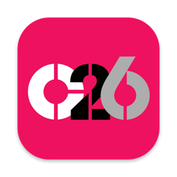
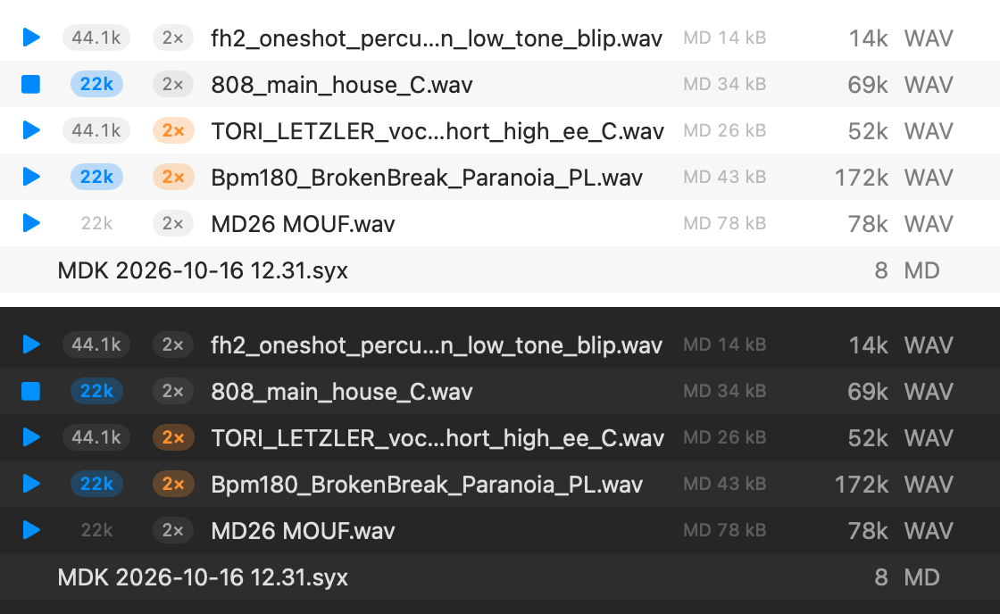
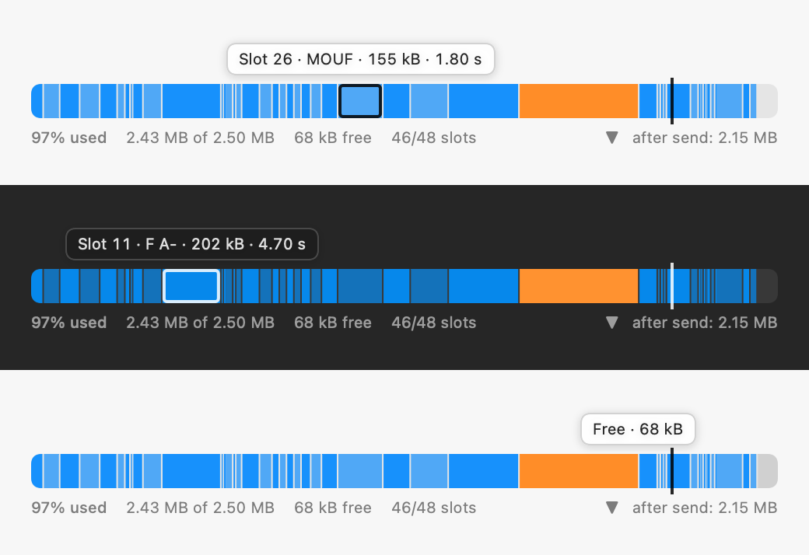

# C2026

**Vibe coded update to Elektron C6 software for use with the TM-1.**

A native macOS rebuild of Elektron's **C6 SysEx Tool** for today's Macs: SysEx and sample transfers to Elektron gear, at TurboMIDI speed through a **TM-1**, on Apple Silicon.

> [!CAUTION]
> **This project is vibe coded. Use it at your own risk.**
>
> It was rebuilt in a day with an AI coding assistant, from the old app's binaries and manual (the original source is lost). It has been tested on exactly one setup: a TM-1 and a Machinedrum UW. Sending samples or SysEx **overwrites data on your device**, and a Machinedrum stores a sample dump in the slot it names even when it isn't armed to receive. **Back up your device first** (C2026 can receive a full dump), and don't use it on anything you can't afford to lose.
>
> C2026 is not affiliated with or endorsed by Elektron. "C6", "Machinedrum", "Monomachine", "TM-1" and "TurboMIDI" are Elektron's names.

---

## 1. Fundamental updates to the original C6

C6 1.51 (2014) was a 32-bit PowerPC/Intel Carbon app; it hasn't run since macOS 10.15. C2026 is a new 64-bit app built from a reverse-engineered spec of the original, with these changes under the hood:

- **Native on Apple Silicon** (macOS 13 or later; an Intel build is one flag away). No Elektron driver needed: the TM-1 is class compliant and runs on Apple's built-in USB MIDI driver.
- **TurboMIDI that actually works on modern macOS.** The TM-1's turbo protocol was recovered from the old app and verified on hardware (query, set speed, status). C6 sped up transfers by overwriting a system-wide CoreMIDI setting (`MaxSysExSpeed`); C2026 paces its own output precisely instead and leaves the system alone.
- **Fixes a macOS bug that corrupts turbo receives.** When a TurboMIDI keep-alive byte lands in the middle of a dump, current macOS ends the SysEx early and drops the rest — about one Machinedrum kit in four, at 10×. C2026 detects the split and rejoins the message (64/64 kits verified).
- **Sample transfers (SDS) rewritten**, with the original's bugs fixed: a NAK resends the right packet (C6 compared the wrong byte, so most NAKs aborted); WAIT is honoured; a missing reply falls back to timed sending (paced at the Machinedrum's own speed, not flat out); 1/60 s timer ticks are replaced by microsecond timing.
- **Safe receiving from a Machinedrum.** Once an MD has had one handshake reply it waits for one on every packet and repeats forever without it, and it only accepts a CANCEL that names the packet it's on. C2026 never stops replying mid-dump and cancels correctly.
- **Samples are sent as 16-bit** (the MD stores 16-bit and plays 12-bit), so 24-bit files go up a third faster.
- **Original bugs fixed** in DigiPRO conversion (FFT and buffer errors that scrambled some lengths), AIFC files (silent or unreadable), 64-bit float WAVs, and a handful of crashes on unusual files. Compatible with C6's files: `.c6` file lists, SysEx and SDS files, and DigiPRO waveforms.

## 2. Quality-of-life additions (not in the original C6)

- **Finds the TM-1 by itself**, reconnects on hot-plug, shows the live turbo speed and can engage turbo before each transfer.
- **Receive stops by itself** a few seconds after the dump ends (C6 needed you to press Stop).
- **Readable names for received data:** short codes plus date and time — `MDK 2026-10-16 12.31.syx` (kits), `MDP` (patterns), `MDS` (songs), `MDG` (globals), combined like `MDGKPS` for a full backup, and `MDK01 …` for a single kit. Received samples are named by slot and name: `MD26 MOUF.wav`.
- **Fast sample receive:** about twice as fast from a Machinedrum at turbo speed, with an automatic re-request if a packet arrives damaged.
- **Play button with a Machinedrum-accurate preview** (mono, 12-bit, at the rate it will be sent) — plus spacebar to play/stop.
- **MD names for samples**, filled in automatically and editable (the 4 letters shown on the Machinedrum); they survive round trips.
- **Send to slot**, numbered like the device (1–48). One sample goes to that slot; a batch fills the following slots; past the last slot you choose *Stop* or *Wrap to slot 1*. A confirmation shows exactly which slots will be replaced.
- **Sample modifiers** — 22 kHz and 2× — to halve (or quarter) the memory a sample uses (see §3).
- **Device Samples window** to see what's on the Machinedrum, how much memory is free, and download any slot (see §4).
- **Memory cost of every sample** in the list, and a running check of whether the selection fits.
- **Export a WAV as a sample-dump `.syx`**, and drag-and-drop everywhere.
- Remembers your files, their options and MD names between launches; imports and exports C6 `.c6` file lists.
- A transfer log (`~/Library/Logs/C2026/C2026.log`) and a MIDI log panel for troubleshooting.
- A command-line companion, `c2026` (see *Building*).

## 3. Sample modifiers: 44.1k / 22k / 2×



Every WAV/AIFF row has three controls before its name:

| Control | What it does |
|---|---|
| **▶** | Plays the sample **as the Machinedrum will**: mono (per the Stereo button), 12-bit, at the rate and speed it will be sent. Space plays/stops the selection. |
| **44.1k / 22k** | Click to send the sample at **22.05 kHz** instead of its own rate. It's resampled with an anti-aliasing filter, uses **half the memory**, and the MD plays it at the right pitch — the cost is the top end above ~11 kHz. |
| **2×** | Click to send the sample at **double speed**: half the frames, original rate in the header. Uses **half the memory**. On the Machinedrum, set that track's **PTCH to −12** to play it at its original speed (C2026's log reminds you after sending). |

- **22k and 2× combine** for a quarter of the memory (the most lo-fi option).
- The **MD memory** column (e.g. `MD 26 kB`) and the selection's fit check update as you toggle.
- The preview follows the toggles, so you can hear the trade-off before spending a transfer. Under **Configure → 22k / 2× playback emulation** you can choose **Gritty** (sample & hold, the default — closest to the Machinedrum by ear) or **Smooth** (linear).
- 22k and 2× store the same data; they sound the same on the MD. Use 22k when you want the sample to play at normal pitch with no extra setup; use 2× if that's your workflow or you want the extra pitch range.

To send: select the samples, set **Send to slot**, press **Send** and confirm.

## 4. Seeing, sizing and downloading the samples on your Machinedrum



Click the **Machinedrum icon** in the toolbar to open **Device Samples**.

1. **Scan** reads every slot's name, length, rate and size from the device — it asks for each sample and cancels after its header, so **nothing on the Machinedrum changes** (about 20 s for 48 slots).
2. The **memory bar** shows each sample as a segment sized by the memory it uses, free space in grey. **Hover** a segment to see its slot, name, size and length; **click** it to select that slot in the table. If samples are selected in the main window, a notch marks where memory use will land after sending them.
3. **Download** pulls the selected slots into your list (named like `MD26 MOUF.wav`), ready to play, edit or keep as a backup.
4. **Send to Slot** makes the selected slot the target for your next send — handy for finding empty slots.

Memory is estimated as **2 bytes per frame, whatever the bit depth** — consistent with a real Machinedrum UW, whose 46 samples added up to 2.43 MB of its 2.5 MB. Set your model under **Configure → Sample memory** (2.5 MB for UW MKII / UW+, 2 MB for MKI) and **Sample slots on device** (48 or 32). The Machinedrum's RAM machines share this memory, so its own sample manager has the final word.

---

## Requirements

- A Mac running macOS 13 or later (built and tested on Apple Silicon, macOS 26).
- An Elektron TM-1 for TurboMIDI (any MIDI interface works at normal speed).
- To build: the Xcode **Command Line Tools** are enough (`xcode-select --install`); full Xcode isn't needed.

## Building

```bash
scripts/build-app.sh                 # → build/C2026.app (Apple Silicon); add --universal for Intel too
scripts/test.sh                      # runs the test suite (Swift Testing)
scripts/make-icon.sh <art.png>       # rebuilds Resources/AppIcon.icns from square artwork
```

The command-line tool (`swift build --product c2026`, then `.build/debug/c2026`) does most of what the app does, which is handy for scripting:

```text
c2026 ports | turbo [status|10x…] | monitor | info <file>
c2026 send <f.syx> | receive [--save f.syx]
c2026 send-sample <f.wav> --slot N [--md-name ABCD] [--22k] [--2x]
c2026 receive-sample --request N [--mode fast|ack] [--save f.wav]
c2026 scan [--slots 1-48] | wav2syx <f.wav> [--slot N] | preview <f.wav> [--22k] [--2x] --save out.wav
```

## Project layout

- `Sources/C6Core` — the engine: CoreMIDI I/O and pacing, TurboMIDI/TM-1, SDS send/receive, Elektron dump recognition, WAV/AIFF, DigiPRO, `.c6` lists, sample memory.
- `Sources/C6App` — the SwiftUI app.
- `Sources/c6cli` — the `c2026` tool.
- `Tests/C6CoreTests` — 180+ tests, including replays of real Machinedrum traffic.

## Credits

C6 SysEx Tool © Elektron Music Machines AB. C2026 is an independent rebuild for owners of the hardware, made with [Claude Code](https://claude.com/claude-code).
